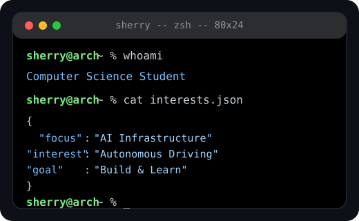

<h3>안녕하세요, 개발자 Sherry입니다. 👋</h3>

  컴퓨터공학을 전공하며 
  소프트웨어와 인공지능을 공부하고 있습니다.

  AI 인프라와 자율주행 시스템에 관심이 있으며, 
  배운 지식을 프로젝트에 적용하고 검증하는 
  과정을 중요하게 생각합니다.

  
  
  
  

 

---

## `GET /about`

- 🎓 **전공:** 컴퓨터공학
- 🔭 **관심 분야:** AI 인프라, 자율주행, 로보틱스
- 📚 **학습 분야:** 알고리즘, 운영체제, 컴퓨터 네트워크, 컴퓨터 구조
- 💻 **개발 환경:** Arch Linux · KDE Plasma
- 🎯 **목표:** 이론과 실무 역량을 모두 갖춘 소프트웨어 엔지니어

---

## `GET /projects`

전공에서 배운 이론을 실제 프로젝트에 적용하며 개발 경험을 쌓고 있습니다.

| 상태 | 프로젝트 | 설명 | 비고 |
|:---:|:---|:---|:---|
| 진행 중 | [**Hypatia**](https://github.com/sherry1248/hypatia-ai-datacenter) | 위성 네트워크 기반 AI 데이터센터 시뮬레이션 | 개인 프로젝트 |
| 진행 중 | **Autonomous Driving** | 자율주행 차량 제어 및 시뮬레이션 | 개인 프로젝트 |
| 완료 | [**스쿨존맵**](https://github.com/sherry1248/Child-Traffic-Accident-Analysis) | 어린이 교통사고 데이터 분석 및 위험 지역 지도 시각화 | 🏆 멋쟁이사자처럼 2등 |
| 완료 | [**Korean Counseling AI**](https://github.com/sherry1248/Korean-Counseling-AI) | 한국어 자연어 처리 기반 심리상담 AI 시스템 | 🏆 멋쟁이사자처럼 2등 |

---

## `GET /experience`

| 기간 | 활동 | 내용 |
|:---|:---|:---|
| 2026 ~ 현재 | 컴퓨터공학 전공 학습 | 운영체제, 네트워크, 알고리즘, 디지털논리설계 등 학습 |
| 부트캠프 기간 | 멋쟁이사자처럼 | 팀 프로젝트 개발 및 2등 수상 경험 |
| 현재 | 개인 프로젝트 | Hypatia, 자율주행 시뮬레이션, 시스템/AI 관련 프로젝트 진행 |

---

## `GET /stack`

### Languages

### Tools & Tech

---

## `GET /github-stats`

---

> 배우고, 구현하고, 검증하며 성장합니다.
